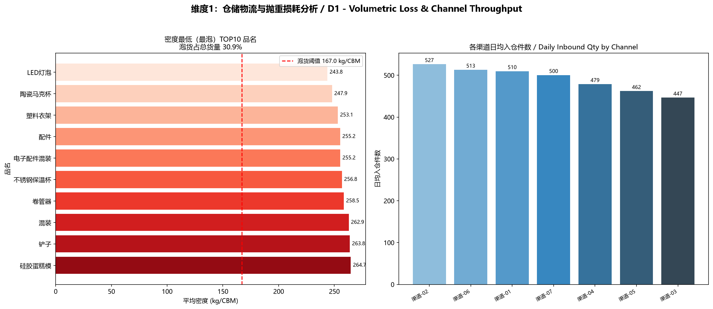
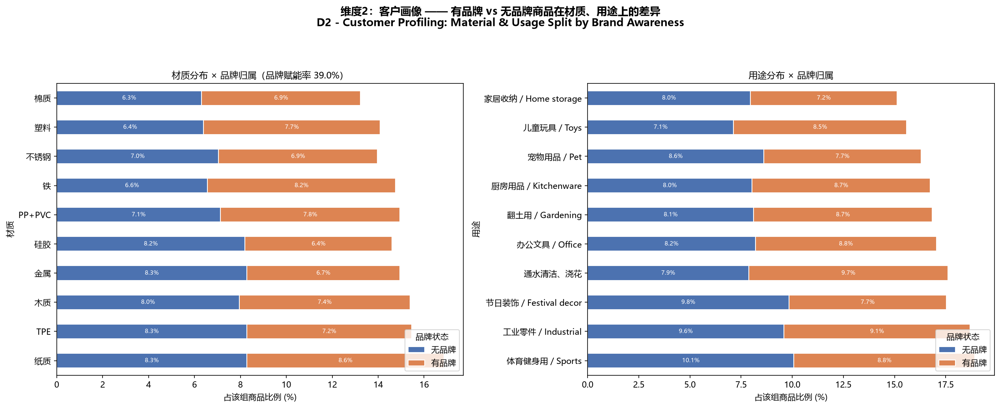
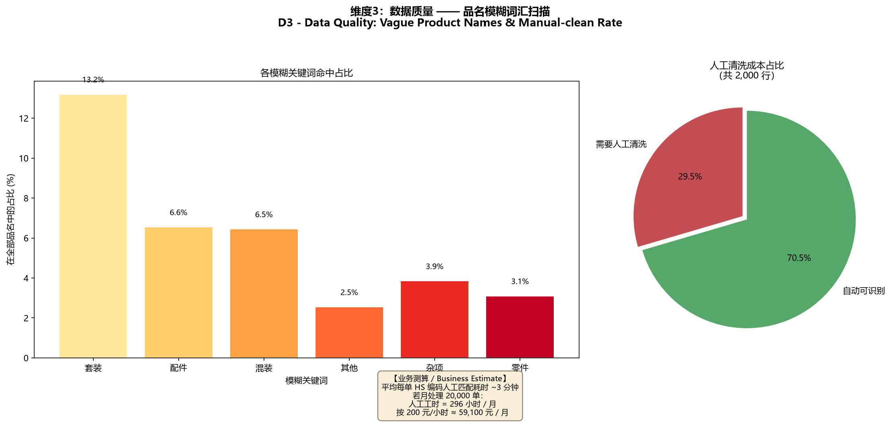
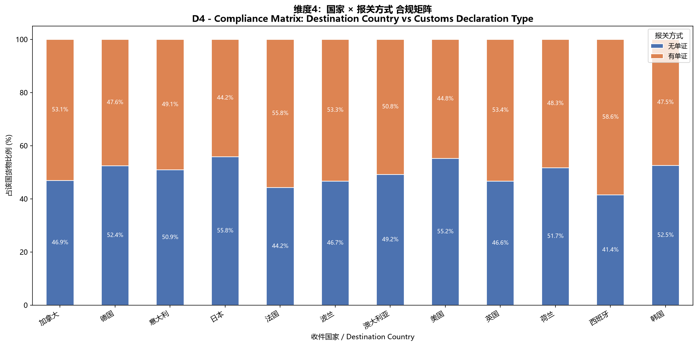

# 清关数据洞察工具包（Customs Data Insight Toolkit）

> 每天对着几十份 Excel 清关资料人工算密度、翻品名、猜 HS 编码？这份 Python 脚本就是为了把那 4 小时的手动核对，变成 5 分钟一键出图 + 一页 Word 报告。

---

## 功能总览

| 功能 | 它做什么 | 人话数字例子 |
|------|---------|-------------|
| 📦 泡货损耗扫描 | 按物流行业标准（密度 < 167 kg/CBM）自动识别"占空间、卖体积"的产品，给 TOP10 排名 | **泡货占 46.5%**（近半集装箱空间被吃掉）→ 一眼看出哪类产品拖后腿 |
| 👤 客户品牌画像 | 统计"有品牌商品"占比，对比他们在材质、用途上的差异 | **品牌赋能率 99.2%**（几乎全在做精细化运营）→ 锁定高净值核心客户 |
| 🧹 品名模糊词检测 | 扫描中文品名里"套装/配件/混装/其他"等模糊词，算出需要人工清洗的比例和每月工时成本 | **1.9% 模糊率 → 月省 19 小时 ≈ 1,900 元** → 直接证明自动化引擎的 ROI |
| 🌐 国家 × 报关合规矩阵 | 收件国家 vs 有单证/无单证的交叉堆叠柱状图 | **德国无单证占 64.9%**（92 单）→ 合规风险点一目了然 |
| 📄 Word 报告生成 | 一键产出带图表 + 表格 + 管理层建议的 .docx 业务洞察报告 | **5 分钟** 生成（原本手动整理 4-6 小时） |
| 🧪 Mock 自测 | 内置 Faker 生成 2000 行逼真数据，clone 下来直接跑通，不需要真实 Excel | **clone 后 3 分钟出结果** → 0 配置 |

---

## 适用场景

- **清关公司数据分析师** —— 每月要给老板出业务分析，想把手动 4 天的活压到 1 天内
- **跨境电商运营** —— 想知道自己卖的品类里哪些在"白给物流成本"
- **供应链经理** —— 想给管理层一份有数字支撑的"为什么要做流程优化"的论证
- **数据产品经理** —— 需要从真实业务数据里挖自动化需求的 ROI 论据

输入都是同一种东西：**一个文件夹里几十份 Excel，每份都有"装柜清单"和"原数据"两张表**。脚本会自动递归扫描所有子文件夹。

---

## Demo 截图（mock 数据生成，无真实客户信息）

### 维度 1：泡货 TOP10 + 渠道入仓



### 维度 2 & 3：客户画像 + 模糊词检测 + 人工成本饼图





### 维度 4：国家 × 报关合规矩阵



---

## 快速开始

### Windows（双击 run.bat）

```batch
run.bat
```

双击等它跑完就行，控制台会告诉你每一步在做什么。结束后打开 `output\` 文件夹看结果。

### macOS / Linux

```bash
chmod +x run.sh
./run.sh
```

### 命令行选项（高级）

```bash
python supply_chain_analyzer.py --mock --rows 5000 --output output_mock   # 调大 mock 数据量
python supply_chain_analyzer.py --real --max-files 30 --output output_real # 读真实 Excel（递归扫描）
python build_word_report.py  --real --max-files 30 --output output_real    # 单独生成 Word
```

输出目录里会同时产生：4 张 PNG 图表、一份 Markdown 报告、一份 Word (.docx) 报告。

---

## 文件清单

| 文件 | 一句话说明 |
|------|-----------|
| `supply_chain_analyzer.py` | 核心分析器（`SupplyChainAnalyzer` 类 + 4 维度方法 + `generate_mock_data()` 自测数据生成器） |
| `build_word_report.py` | 把分析结果打包成带图表、表格、管理层建议的 Word 报告 |
| `run.bat` / `run.sh` | 一键启动脚本（自动装依赖、跑 mock、出结果） |
| `demo/` | README 里引用的 4 张 Demo 截图（脱敏 mock 数据） |
| `.gitignore` | 屏蔽真实 Excel、输出产物、缓存；只推源码 |

---

## 技术栈

`Python 3.9+` · `pandas` · `numpy` · `matplotlib` · `seaborn` · `openpyxl` · `python-docx` · `Faker`

依赖一行装完：

```bash
python -m pip install pandas numpy matplotlib seaborn openpyxl python-docx faker
```

---

## Summary（English）

A Python toolkit for customs-clearance / supply-chain teams that reads real Excel workbooks and produces **4 charts + a Word (.docx) insight report** in one click.

- 4 dimensions: **volumetric loss**, **customer profiling**, **data-quality cost**, **compliance matrix**
- Includes a **Faker-based mock-data generator** so anyone can clone & run self-tests with zero real data
- Real-world pain point it solves: **4–6 hours of manual report-writing → 5 minutes**
- All scripts have been privacy-sanitized; `.gitignore` blocks real Excel datasets
